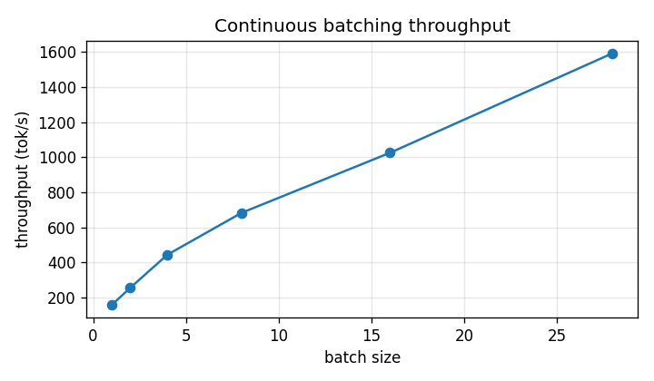
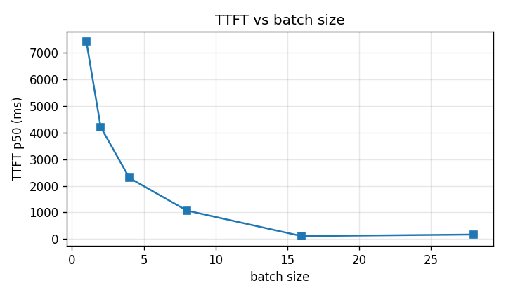
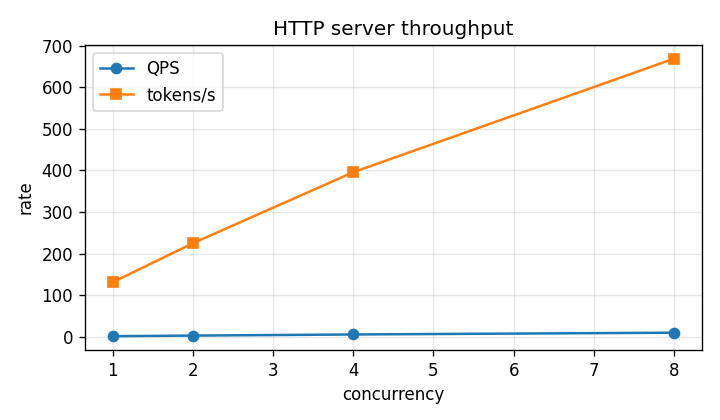
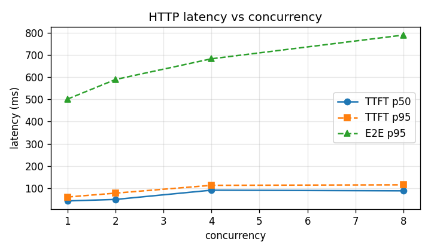
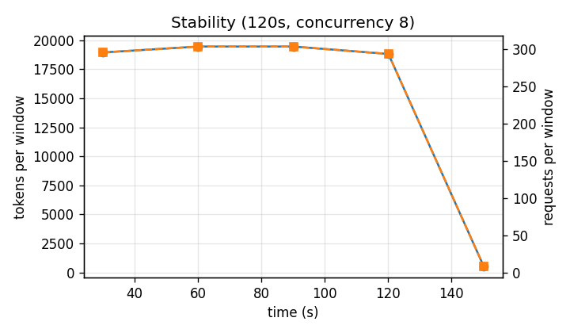

# 压测报告（BENCHMARK）

> 由 `scripts/make_bench_report.py` 从压测 JSON 自动生成。

## 1. 连续批处理（bench_batched，引擎级）

> 模型 `/data/hjt1/Qwen3-0.6B`，32 序列，input [32, 256]，output [32, 128]，CUDA Graph=True
>
> **TTFT 口径**：所有请求在同一时刻离线到达，因此 batched 的 TTFT包含在 waiting 中的排队时间（batch 越小排队越长）；serial 为逐请求执行（无排队，TTFT≈prefill 时间）。HTTP 压测的 TTFT 为真实并发视角。

| Mode | Batch | Throughput | TTFT p50 | TTFT p95 | TPOT | Decode ms/tok | Lat p50 | Lat p95 |
|---|---:|---:|---:|---:|---:|---:|---:|---:|
| serial | 1 | 31.1 tok/s | 32.9ms | 41.0ms | 31.68ms | 31.66 ms/tok | 41.28s | 76.45s |
| batched | 1 | 158.1 tok/s | 7437.4ms | 14459.8ms | 5.86ms | 5.86 ms/tok | 8.10s | 15.03s |
| batched | 2 | 256.1 tok/s | 4209.3ms | 8550.7ms | 3.47ms | 3.47 ms/tok | 5.01s | 9.25s |
| batched | 4 | 444.7 tok/s | 2294.7ms | 4836.9ms | 1.84ms | 1.84 ms/tok | 2.97s | 5.48s |
| batched | 8 | 683.3 tok/s | 1070.1ms | 2755.6ms | 1.10ms | 1.10 ms/tok | 2.08s | 3.43s |
| batched | 16 | 1025.4 tok/s | 107.7ms | 1493.9ms | 0.72ms | 0.72 ms/tok | 1.58s | 2.26s |
| batched | 28 | 1592.8 tok/s | 167.8ms | 604.6ms | 0.51ms | 0.50 ms/tok | 1.01s | 1.35s |

## 2. HTTP 服务（bench_server）

> 并发梯度，stream=True，max_tokens=64，prompt≈1575 chars

| 并发 | OK/Total | 错误率 | QPS | tok/s | TTFT p50 | TTFT p95 | Lat p50 | Lat p95 | Lat p99 |
|---:|---:|---:|---:|---:|---:|---:|---:|---:|---:|
| 1 | 32/32 | 0.0% | 2.1 | 131.8 | 42.7ms | 60.3ms | 483ms | 501ms | 558ms |
| 2 | 32/32 | 0.0% | 3.5 | 225.4 | 49.4ms | 77.8ms | 557ms | 590ms | 594ms |
| 4 | 32/32 | 0.0% | 6.2 | 395.9 | 91.1ms | 112.9ms | 649ms | 683ms | 685ms |
| 8 | 32/32 | 0.0% | 10.4 | 668.5 | 88.1ms | 115.0ms | 767ms | 790ms | 790ms |

## 3. 长稳测试

> 时长 120s，并发 8，stream=True

| 请求数 | 错误率 | QPS | tok/s | TTFT p50 | TTFT p95 | Lat p50 | Lat p95 | Lat p99 |
|---:|---:|---:|---:|---:|---:|---:|---:|---:|
| 1206/1206 | 0.0% | 8.0 | 514.0 | 93.6ms | 162.6ms | 797ms | 850ms | 868ms |

窗口（每 30s）请求数与 tokens（无衰减 = 稳定）：

| t(s) | 累计请求 | 累计 tokens | 错误 |
|---:|---:|---:|---:|
| 30.0 | 296 | 18944 | 0 |
| 60.1 | 600 | 38400 | 0 |
| 90.1 | 904 | 57856 | 0 |
| 120.1 | 1198 | 76672 | 0 |
| 150.2 | 1206 | 77184 | 0 |

## 曲线

